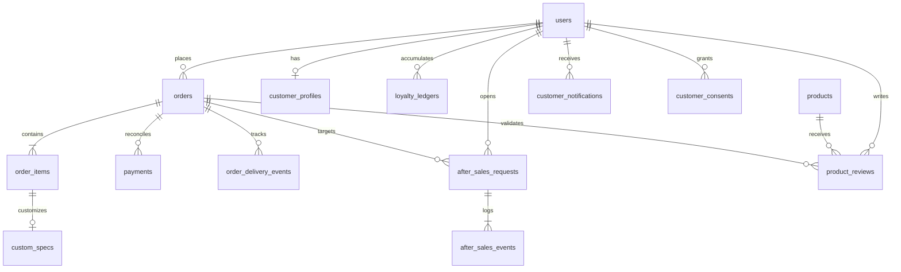

# THIẾT KẾ MÔ HÌNH DỮ LIỆU CUSTOMER RETENTION (DATA MODEL)
**Tài liệu:** `CUSTOMER_RETENTION_DATA_MODEL.md`  
**Phiên bản:** 1.0 — Database Schema & Data Dictionary  
**Trạng thái:** DRAFT / Đề xuất thiết kế (Chưa chạy Migration lên database)

---

## 1. MỐI QUAN HỆ CÁC THỰC THỂ (ERD DIAGRAM)



---

## 2. CHI TIẾT CÁC BẢNG DỮ LIỆU ĐỀ XUẤT (PROPOSED SCHEMAS)

### 2.1. Bảng `customer_profiles` (Hồ sơ khách hàng & Thẻ thành viên)
Lưu thông tin bổ trợ khách hàng, điểm tích luỹ, hạng thành viên và sở thích phong cách kính.

| Tên cột | Kiểu dữ liệu | Ràng buộc | Mô tả |
|---|---|---|---|
| `id` | BIGINT UNSIGNED | AUTO_INCREMENT, PK | Mã định danh hồ sơ |
| `user_id` | VARCHAR(100) | NOT NULL, UNIQUE, INDEX | ID khách hàng (khớp với `orders.user_id`) |
| `full_name` | VARCHAR(255) | NOT NULL | Họ và tên khách hàng |
| `phone` | VARCHAR(50) | NULL | Số điện thoại liên hệ |
| `email` | VARCHAR(255) | NOT NULL | Địa chỉ email |
| `membership_tier` | ENUM('member', 'silver', 'gold', 'diamond') | NOT NULL, DEFAULT 'member' | Hạng thành viên hiện tại |
| `loyalty_points` | INT NOT NULL | DEFAULT 0 | Điểm thưởng khả dụng hiện tại |
| `lifetime_points` | INT NOT NULL | DEFAULT 0 | Tổng điểm đã tích lũy trong toàn bộ lịch sử |
| `total_spent` | DECIMAL(12, 2) | NOT NULL, DEFAULT 0.00 | Tổng tiền đã mua hàng thành công |
| `saved_face_shape` | VARCHAR(50) | NULL | Dáng mặt đã nhận diện từ Face Stylist (Oval, Round, v.v.) |
| `birthdate` | DATE | NULL | Ngày sinh (để phục vụ ưu đãi sinh nhật) |
| `created_at` | TIMESTAMP | DEFAULT CURRENT_TIMESTAMP | Thời điểm tạo hồ sơ |
| `updated_at` | TIMESTAMP | DEFAULT CURRENT_TIMESTAMP ON UPDATE CURRENT_TIMESTAMP | Cập nhật gần nhất |

---

### 2.2. Bảng `loyalty_ledgers` (Sổ cái biến động điểm thưởng)
Theo nguyên tắc **Double-Entry Ledger**, tuyệt đối không cập nhật điểm tuỳ tiện mà mọi biến động đều phải có một dòng lịch sử với bằng chứng giao dịch và khoá chống trùng lặp (`idempotency_key`).

| Tên cột | Kiểu dữ liệu | Ràng buộc | Mô tả |
|---|---|---|---|
| `id` | BIGINT UNSIGNED | AUTO_INCREMENT, PK | Khóa chính |
| `user_id` | VARCHAR(100) | NOT NULL, INDEX | ID khách hàng nhận/trừ điểm |
| `transaction_type` | ENUM('earn_order', 'redeem_order', 'review_reward', 'admin_adjustment', 'refund_deduct', 'expire') | NOT NULL | Loại giao dịch biến động điểm |
| `points_change` | INT NOT NULL | NOT NULL | Số điểm thay đổi (Dương: cộng; Âm: trừ) |
| `balance_after` | INT NOT NULL | NOT NULL | Số dư điểm sau khi giao dịch hoàn tất |
| `reference_type` | ENUM('order', 'review', 'care_request', 'admin') | NOT NULL | Nguồn gốc giao dịch |
| `reference_id` | VARCHAR(100) | NOT NULL | Mã tham chiếu (mã đơn, mã review, v.v.) |
| `idempotency_key` | VARCHAR(128) | NOT NULL, UNIQUE | Khóa kiểm soát tránh cộng/trừ 2 lần |
| `description` | VARCHAR(500) | NOT NULL | Diễn giải lý do biến động điểm |
| `created_by` | VARCHAR(100) | NOT NULL | Người thực hiện (`system` hoặc `admin_id`) |
| `created_at` | TIMESTAMP | DEFAULT CURRENT_TIMESTAMP, INDEX | Thời điểm phát sinh giao dịch |

---

### 2.3. Bảng `order_delivery_events` (Sự kiện & Bằng chứng giao nhận hàng)
Giải quyết triệt để vấn đề hệ thống hiện tại **chưa có cơ chế xác nhận giao hàng thực tế**.

| Tên cột | Kiểu dữ liệu | Ràng buộc | Mô tả |
|---|---|---|---|
| `id` | BIGINT UNSIGNED | AUTO_INCREMENT, PK | Khóa chính |
| `order_id` | INT | NOT NULL, FK -> `orders.id` | Mã đơn hàng liên quan |
| `carrier_name` | VARCHAR(100) | NULL | Đơn vị vận chuyển (Nội bộ Lumina, GHN, ViettelPost) |
| `tracking_code` | VARCHAR(100) | NULL | Mã vận đơn |
| `delivered_at` | TIMESTAMP | NOT NULL | Thời điểm đơn hàng được giao đến tay khách |
| `confirmed_by` | ENUM('customer', 'admin', 'system') | NOT NULL | Đối tượng xác nhận giao nhận |
| `confirmed_by_id` | VARCHAR(100) | NOT NULL | ID người xác nhận (khách bấm hoặc nhân viên) |
| `proof_note` | VARCHAR(500) | NULL | Ghi chú bằng chứng giao hàng |
| `created_at` | TIMESTAMP | DEFAULT CURRENT_TIMESTAMP | Thời điểm ghi nhận sự kiện |

---

### 2.4. Bảng `after_sales_requests` (Yêu cầu bảo hành & Chăm sóc Lumina Care)
Quản lý các phiếu hỗ trợ (Ticket) từ khách hàng gửi về.

| Tên cột | Kiểu dữ liệu | Ràng buộc | Mô tả |
|---|---|---|---|
| `id` | BIGINT UNSIGNED | AUTO_INCREMENT, PK | Khóa chính |
| `ticket_code` | VARCHAR(50) | NOT NULL, UNIQUE, INDEX | Mã phiếu hỗ trợ (Ví dụ: `CARE-202611-A8F2`) |
| `user_id` | VARCHAR(100) | NOT NULL, INDEX | ID khách hàng tạo yêu cầu |
| `order_id` | INT | NULL, FK -> `orders.id` | Đơn hàng cần hỗ trợ (nếu có) |
| `order_item_id` | INT | NULL, FK -> `order_items.id` | Sản phẩm cụ thể trong đơn (nếu có) |
| `request_type` | ENUM('warranty_claim', 'fit_adjustment', 'deep_cleaning', 'repair_service', 'usage_consultation', 'other') | NOT NULL | Loại dịch vụ yêu cầu |
| `priority` | ENUM('low', 'medium', 'high', 'urgent') | NOT NULL, DEFAULT 'medium' | Mức độ ưu tiên |
| `status` | ENUM('submitted', 'reviewing', 'waiting_customer', 'approved', 'in_progress', 'resolved', 'rejected', 'closed') | NOT NULL, DEFAULT 'submitted' | Trạng thái xử lý |
| `title` | VARCHAR(255) | NOT NULL | Tiêu đề ngắn gọn về vấn đề |
| `description` | TEXT | NOT NULL | Chi tiết mô tả lỗi hoặc mong muốn của khách |
| `contact_phone` | VARCHAR(50) | NOT NULL | Số điện thoại liên hệ trực tiếp |
| `assigned_to` | VARCHAR(100) | NULL | Kỹ thuật viên / Quản trị viên phụ trách |
| `resolution_summary` | TEXT | NULL | Tóm tắt kết quả xử lý từ phía Lumina |
| `customer_rating` | TINYINT | NULL | Đánh giá mức độ hài lòng của khách (1 - 5 sao) |
| `customer_feedback` | TEXT | NULL | Ý kiến đóng góp sau khi đóng ticket |
| `created_at` | TIMESTAMP | DEFAULT CURRENT_TIMESTAMP | Thời điểm tạo phiếu |
| `updated_at` | TIMESTAMP | DEFAULT CURRENT_TIMESTAMP ON UPDATE CURRENT_TIMESTAMP | Cập nhật gần nhất |
| `resolved_at` | TIMESTAMP | NULL | Thời điểm xử lý xong |
| `closed_at` | TIMESTAMP | NULL | Thời điểm đóng phiếu chính thức |

---

### 2.5. Bảng `after_sales_events` (Nhật ký xử lý & Trao đổi ticket)
Ghi lại mọi diễn biến xử lý, tin nhắn giữa khách và kỹ thuật viên, cùng ghi chú nội bộ tách biệt.

| Tên cột | Kiểu dữ liệu | Ràng buộc | Mô tả |
|---|---|---|---|
| `id` | BIGINT UNSIGNED | AUTO_INCREMENT, PK | Khóa chính |
| `request_id` | BIGINT UNSIGNED | NOT NULL, FK -> `after_sales_requests.id` | Phiếu hỗ trợ liên kết |
| `actor_type` | ENUM('customer', 'admin', 'system') | NOT NULL | Người thực hiện hành động |
| `actor_id` | VARCHAR(100) | NOT NULL | ID người thực hiện |
| `event_type` | ENUM('status_change', 'customer_message', 'staff_response', 'internal_note') | NOT NULL | Loại sự kiện |
| `content` | TEXT | NOT NULL | Nội dung phản hồi hoặc ghi chú |
| `is_internal_only` | TINYINT(1) | NOT NULL, DEFAULT 0 | 1: Chỉ nội bộ Admin nhìn thấy; 0: Khách hàng nhìn thấy |
| `created_at` | TIMESTAMP | DEFAULT CURRENT_TIMESTAMP | Thời điểm ghi nhận |

---

### 2.6. Bảng `product_reviews` (Đánh giá sản phẩm đã xác minh mua)
Lưu đánh giá sản phẩm từ khách hàng đã mua thực tế.

| Tên cột | Kiểu dữ liệu | Ràng buộc | Mô tả |
|---|---|---|---|
| `id` | BIGINT UNSIGNED | AUTO_INCREMENT, PK | Khóa chính |
| `product_id` | VARCHAR(50) | NOT NULL, INDEX | ID sản phẩm (khớp với `products.id`) |
| `order_id` | INT | NOT NULL, FK -> `orders.id` | Đơn hàng mua sản phẩm này |
| `user_id` | VARCHAR(100) | NOT NULL, INDEX | ID khách hàng viết đánh giá |
| `author_name` | VARCHAR(255) | NOT NULL | Tên hiển thị người đánh giá |
| `rating` | TINYINT | NOT NULL (1 đến 5) | Số sao đánh giá |
| `review_title` | VARCHAR(255) | NULL | Tiêu đề đánh giá |
| `review_content` | TEXT | NOT NULL | Nội dung nhận xét chi tiết |
| `is_verified_buyer` | TINYINT(1) | NOT NULL, DEFAULT 1 | Cờ xác nhận người mua thực |
| `status` | ENUM('pending', 'approved', 'rejected') | NOT NULL, DEFAULT 'approved' | Trạng thái kiểm duyệt |
| `admin_notes` | VARCHAR(500) | NULL | Ghi chú của quản trị viên khi duyệt |
| `created_at` | TIMESTAMP | DEFAULT CURRENT_TIMESTAMP | Thời điểm gửi đánh giá |
| `updated_at` | TIMESTAMP | DEFAULT CURRENT_TIMESTAMP ON UPDATE CURRENT_TIMESTAMP | Cập nhật gần nhất |

---

### 2.7. Bảng `customer_notifications` (Hộp thư thông báo trong ứng dụng)
Cung cấp kênh thông báo In-app cho khách hàng vì hệ thống chưa tích hợp nhà cung cấp Email/SMS bên ngoài.

| Tên cột | Kiểu dữ liệu | Ràng buộc | Mô tả |
|---|---|---|---|
| `id` | BIGINT UNSIGNED | AUTO_INCREMENT, PK | Khóa chính |
| `user_id` | VARCHAR(100) | NOT NULL, INDEX | ID khách hàng nhận thông báo |
| `title` | VARCHAR(255) | NOT NULL | Tiêu đề thông báo |
| `message` | TEXT | NOT NULL | Nội dung chi tiết |
| `type` | ENUM('order_status', 'care_ticket', 'loyalty', 'system', 'promotion') | NOT NULL | Loại thông báo |
| `reference_type` | VARCHAR(50) | NULL | Thực thể liên quan (`order`, `ticket`) |
| `reference_id` | VARCHAR(100) | NULL | Mã thực thể liên quan |
| `is_read` | TINYINT(1) | NOT NULL, DEFAULT 0 | 0: Chưa đọc; 1: Đã đọc |
| `created_at` | TIMESTAMP | DEFAULT CURRENT_TIMESTAMP, INDEX | Thời điểm gửi thông báo |

---

### 2.8. Bảng `customer_consents` (Lưu trữ sự đồng ý nhận tin & tiếp thị)
Tuân thủ quy chuẩn bảo mật dữ liệu cá nhân, ghi nhận sự đồng ý nhận tin tiếp thị.

| Tên cột | Kiểu dữ liệu | Ràng buộc | Mô tả |
|---|---|---|---|
| `id` | BIGINT UNSIGNED | AUTO_INCREMENT, PK | Khóa chính |
| `user_id` | VARCHAR(100) | NOT NULL, INDEX | ID khách hàng |
| `consent_type` | ENUM('email_marketing', 'sms_marketing', 'care_reminders') | NOT NULL | Loại đồng ý |
| `is_granted` | TINYINT(1) | NOT NULL, DEFAULT 0 | 1: Đồng ý; 0: Từ chối / Huỷ |
| `ip_address` | VARCHAR(50) | NULL | Địa chỉ IP khi bấm đồng ý |
| `user_agent` | VARCHAR(255) | NULL | Thông tin trình duyệt |
| `updated_at` | TIMESTAMP | DEFAULT CURRENT_TIMESTAMP ON UPDATE CURRENT_TIMESTAMP | Thời điểm ghi nhận |

---

## 3. FILE SQL MIGRATION DỰ KIẾN (`004_create_customer_retention_tables.sql`)

```sql
-- Migration 004: Create Customer Retention Ecosystem Tables
-- Target: MySQL / MariaDB (XAMPP Environment)
-- Safe to execute: uses CREATE TABLE IF NOT EXISTS

USE `lumina_eyewear_db`;

-- 1. Profiles & Membership
CREATE TABLE IF NOT EXISTS `customer_profiles` (
  `id` BIGINT UNSIGNED NOT NULL AUTO_INCREMENT,
  `user_id` VARCHAR(100) NOT NULL,
  `full_name` VARCHAR(255) NOT NULL,
  `phone` VARCHAR(50) NULL,
  `email` VARCHAR(255) NOT NULL,
  `membership_tier` ENUM('member', 'silver', 'gold', 'diamond') NOT NULL DEFAULT 'member',
  `loyalty_points` INT NOT NULL DEFAULT 0,
  `lifetime_points` INT NOT NULL DEFAULT 0,
  `total_spent` DECIMAL(12, 2) NOT NULL DEFAULT 0.00,
  `saved_face_shape` VARCHAR(50) NULL,
  `birthdate` DATE NULL,
  `created_at` TIMESTAMP NOT NULL DEFAULT CURRENT_TIMESTAMP,
  `updated_at` TIMESTAMP NOT NULL DEFAULT CURRENT_TIMESTAMP ON UPDATE CURRENT_TIMESTAMP,
  PRIMARY KEY (`id`),
  UNIQUE KEY `uk_customer_profiles_user` (`user_id`)
) ENGINE=InnoDB DEFAULT CHARSET=utf8mb4 COLLATE=utf8mb4_unicode_ci;

-- 2. Loyalty Ledgers
CREATE TABLE IF NOT EXISTS `loyalty_ledgers` (
  `id` BIGINT UNSIGNED NOT NULL AUTO_INCREMENT,
  `user_id` VARCHAR(100) NOT NULL,
  `transaction_type` ENUM('earn_order', 'redeem_order', 'review_reward', 'admin_adjustment', 'refund_deduct', 'expire') NOT NULL,
  `points_change` INT NOT NULL,
  `balance_after` INT NOT NULL,
  `reference_type` ENUM('order', 'review', 'care_request', 'admin') NOT NULL,
  `reference_id` VARCHAR(100) NOT NULL,
  `idempotency_key` VARCHAR(128) NOT NULL,
  `description` VARCHAR(500) NOT NULL,
  `created_by` VARCHAR(100) NOT NULL DEFAULT 'system',
  `created_at` TIMESTAMP NOT NULL DEFAULT CURRENT_TIMESTAMP,
  PRIMARY KEY (`id`),
  UNIQUE KEY `uk_loyalty_idempotency` (`idempotency_key`),
  INDEX `idx_loyalty_user` (`user_id`, `created_at`)
) ENGINE=InnoDB DEFAULT CHARSET=utf8mb4 COLLATE=utf8mb4_unicode_ci;

-- 3. Delivery Confirmation Events
CREATE TABLE IF NOT EXISTS `order_delivery_events` (
  `id` BIGINT UNSIGNED NOT NULL AUTO_INCREMENT,
  `order_id` INT NOT NULL,
  `carrier_name` VARCHAR(100) NULL,
  `tracking_code` VARCHAR(100) NULL,
  `delivered_at` TIMESTAMP NOT NULL,
  `confirmed_by` ENUM('customer', 'admin', 'system') NOT NULL DEFAULT 'admin',
  `confirmed_by_id` VARCHAR(100) NOT NULL,
  `proof_note` VARCHAR(500) NULL,
  `created_at` TIMESTAMP NOT NULL DEFAULT CURRENT_TIMESTAMP,
  PRIMARY KEY (`id`),
  INDEX `idx_delivery_order` (`order_id`),
  CONSTRAINT `fk_delivery_order` FOREIGN KEY (`order_id`) REFERENCES `orders` (`id`) ON DELETE CASCADE
) ENGINE=InnoDB DEFAULT CHARSET=utf8mb4 COLLATE=utf8mb4_unicode_ci;

-- 4. After-sales & Warranty Requests
CREATE TABLE IF NOT EXISTS `after_sales_requests` (
  `id` BIGINT UNSIGNED NOT NULL AUTO_INCREMENT,
  `ticket_code` VARCHAR(50) NOT NULL,
  `user_id` VARCHAR(100) NOT NULL,
  `order_id` INT NULL,
  `order_item_id` INT NULL,
  `request_type` ENUM('warranty_claim', 'fit_adjustment', 'deep_cleaning', 'repair_service', 'usage_consultation', 'other') NOT NULL,
  `priority` ENUM('low', 'medium', 'high', 'urgent') NOT NULL DEFAULT 'medium',
  `status` ENUM('submitted', 'reviewing', 'waiting_customer', 'approved', 'in_progress', 'resolved', 'rejected', 'closed') NOT NULL DEFAULT 'submitted',
  `title` VARCHAR(255) NOT NULL,
  `description` TEXT NOT NULL,
  `contact_phone` VARCHAR(50) NOT NULL,
  `assigned_to` VARCHAR(100) NULL,
  `resolution_summary` TEXT NULL,
  `customer_rating` TINYINT NULL,
  `customer_feedback` TEXT NULL,
  `created_at` TIMESTAMP NOT NULL DEFAULT CURRENT_TIMESTAMP,
  `updated_at` TIMESTAMP NOT NULL DEFAULT CURRENT_TIMESTAMP ON UPDATE CURRENT_TIMESTAMP,
  `resolved_at` TIMESTAMP NULL DEFAULT NULL,
  `closed_at` TIMESTAMP NULL DEFAULT NULL,
  PRIMARY KEY (`id`),
  UNIQUE KEY `uk_care_ticket_code` (`ticket_code`),
  INDEX `idx_care_user` (`user_id`),
  INDEX `idx_care_status` (`status`),
  CONSTRAINT `fk_care_order` FOREIGN KEY (`order_id`) REFERENCES `orders` (`id`) ON DELETE SET NULL,
  CONSTRAINT `fk_care_order_item` FOREIGN KEY (`order_item_id`) REFERENCES `order_items` (`id`) ON DELETE SET NULL
) ENGINE=InnoDB DEFAULT CHARSET=utf8mb4 COLLATE=utf8mb4_unicode_ci;

-- 5. After-sales Events & Messages
CREATE TABLE IF NOT EXISTS `after_sales_events` (
  `id` BIGINT UNSIGNED NOT NULL AUTO_INCREMENT,
  `request_id` BIGINT UNSIGNED NOT NULL,
  `actor_type` ENUM('customer', 'admin', 'system') NOT NULL,
  `actor_id` VARCHAR(100) NOT NULL,
  `event_type` ENUM('status_change', 'customer_message', 'staff_response', 'internal_note') NOT NULL,
  `content` TEXT NOT NULL,
  `is_internal_only` TINYINT(1) NOT NULL DEFAULT 0,
  `created_at` TIMESTAMP NOT NULL DEFAULT CURRENT_TIMESTAMP,
  PRIMARY KEY (`id`),
  INDEX `idx_events_request` (`request_id`, `created_at`),
  CONSTRAINT `fk_events_request` FOREIGN KEY (`request_id`) REFERENCES `after_sales_requests` (`id`) ON DELETE CASCADE
) ENGINE=InnoDB DEFAULT CHARSET=utf8mb4 COLLATE=utf8mb4_unicode_ci;

-- 6. Product Reviews (Verified Purchases)
CREATE TABLE IF NOT EXISTS `product_reviews` (
  `id` BIGINT UNSIGNED NOT NULL AUTO_INCREMENT,
  `product_id` VARCHAR(50) NOT NULL,
  `order_id` INT NOT NULL,
  `user_id` VARCHAR(100) NOT NULL,
  `author_name` VARCHAR(255) NOT NULL,
  `rating` TINYINT NOT NULL,
  `review_title` VARCHAR(255) NULL,
  `review_content` TEXT NOT NULL,
  `is_verified_buyer` TINYINT(1) NOT NULL DEFAULT 1,
  `status` ENUM('pending', 'approved', 'rejected') NOT NULL DEFAULT 'approved',
  `admin_notes` VARCHAR(500) NULL,
  `created_at` TIMESTAMP NOT NULL DEFAULT CURRENT_TIMESTAMP,
  `updated_at` TIMESTAMP NOT NULL DEFAULT CURRENT_TIMESTAMP ON UPDATE CURRENT_TIMESTAMP,
  PRIMARY KEY (`id`),
  UNIQUE KEY `uk_review_user_order_product` (`user_id`, `order_id`, `product_id`),
  INDEX `idx_reviews_product` (`product_id`, `status`),
  CONSTRAINT `fk_review_order` FOREIGN KEY (`order_id`) REFERENCES `orders` (`id`) ON DELETE CASCADE,
  CONSTRAINT `fk_review_product` FOREIGN KEY (`product_id`) REFERENCES `products` (`id`) ON DELETE CASCADE
) ENGINE=InnoDB DEFAULT CHARSET=utf8mb4 COLLATE=utf8mb4_unicode_ci;

-- 7. In-app Customer Notifications
CREATE TABLE IF NOT EXISTS `customer_notifications` (
  `id` BIGINT UNSIGNED NOT NULL AUTO_INCREMENT,
  `user_id` VARCHAR(100) NOT NULL,
  `title` VARCHAR(255) NOT NULL,
  `message` TEXT NOT NULL,
  `type` ENUM('order_status', 'care_ticket', 'loyalty', 'system', 'promotion') NOT NULL,
  `reference_type` VARCHAR(50) NULL,
  `reference_id` VARCHAR(100) NULL,
  `is_read` TINYINT(1) NOT NULL DEFAULT 0,
  `created_at` TIMESTAMP NOT NULL DEFAULT CURRENT_TIMESTAMP,
  PRIMARY KEY (`id`),
  INDEX `idx_notifications_user` (`user_id`, `is_read`, `created_at`)
) ENGINE=InnoDB DEFAULT CHARSET=utf8mb4 COLLATE=utf8mb4_unicode_ci;

-- 8. Customer Marketing Consents
CREATE TABLE IF NOT EXISTS `customer_consents` (
  `id` BIGINT UNSIGNED NOT NULL AUTO_INCREMENT,
  `user_id` VARCHAR(100) NOT NULL,
  `consent_type` ENUM('email_marketing', 'sms_marketing', 'care_reminders') NOT NULL,
  `is_granted` TINYINT(1) NOT NULL DEFAULT 0,
  `ip_address` VARCHAR(50) NULL,
  `user_agent` VARCHAR(255) NULL,
  `updated_at` TIMESTAMP NOT NULL DEFAULT CURRENT_TIMESTAMP ON UPDATE CURRENT_TIMESTAMP,
  PRIMARY KEY (`id`),
  UNIQUE KEY `uk_user_consent_type` (`user_id`, `consent_type`)
) ENGINE=InnoDB DEFAULT CHARSET=utf8mb4 COLLATE=utf8mb4_unicode_ci;
```

