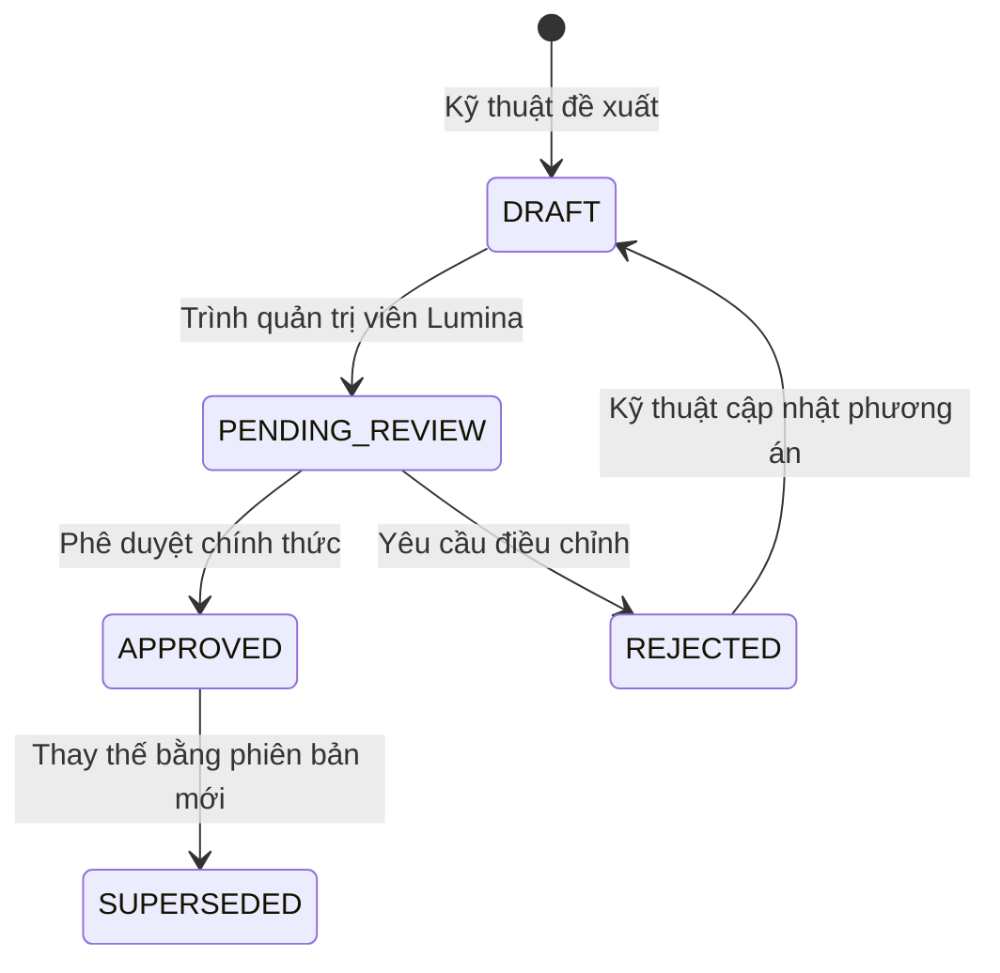

# SỔ ĐĂNG KÝ QUYẾT ĐỊNH NGHIỆP VỤ (DECISION REGISTER)
**Dự án:** Lumina Eyewear — Nền tảng Kính mắt 3D Bespoke & Chăm sóc Khách hàng  
**Tài liệu:** `docs/DECISION_REGISTER.md`  
**Phiên bản:** 2.0 — Đã phê duyệt chính thức cho Triển khai Dự án & Môi trường Demo  
**Ngày cập nhật:** 2026-11-12  
**Người phê duyệt:** Lumina Eyewear Executive / Project Admin  
**Trạng thái chung:** `APPROVED FOR PROJECT IMPLEMENTATION / DEMO`

---

## 1. NGUYÊN TẮC BẮT BUỘC TRONG QUẢN TRỊ QUYẾT ĐỊNH

1. **Tuyệt đối không hardcode chính sách vào mã nguồn:**  
   Mọi hằng số thời hạn bảo hành, tỷ lệ điểm, hạn mức đổi trả phải được đọc từ bộ nạp cấu hình động (`ConfigService` / `system_configurations`).
2. **Tuân thủ đúng phê duyệt chính thức:**  
   Toàn bộ tham số đã được phê duyệt ở trạng thái `APPROVED FOR PROJECT IMPLEMENTATION / DEMO`. Khi hiển thị công khai trên môi trường thật, cần hoàn thiện rà soát pháp lý lần cuối trước khi kích hoạt quy mô lớn.
3. **Phân tách rạch ròi Môi trường Thử nghiệm (Demo) và Vận hành (Production):**  
   - `DEMO_MODE=true`: Dùng cấu hình tham chiếu đã phê duyệt để kiểm thử và hoàn thiện toàn bộ các phân hệ After-Sales & Retention.
   - `PRODUCTION`: Áp dụng cấu hình có chữ ký duyệt số (`APPROVED`) của Quản trị viên Lumina.
4. **Bảo toàn tính toàn vẹn và không hủy hoại:**  
   Không thực hiện migration phá vỡ cấu trúc cơ sở dữ liệu hiện tại (`orders`, `order_items`, `custom_specs`, `products`, `payments`).
5. **Lưu vết kiểm toán (Audit Trail) cho mọi thay đổi:**  
   Mọi lần phê duyệt, từ chối hoặc điều chỉnh tham số đều phải lưu người đổi (`approved_by`), thời điểm (`approved_at`), phiên bản (`version`) và lý do thay đổi.

---

## 2. VÒNG ĐỜI TRẠNG THÁI QUYẾT ĐỊNH (DECISION LIFECYCLE)



- **`DRAFT`**: Đề xuất kỹ thuật, chỉ áp dụng hiển thị minh họa hoặc trong môi trường test/demo.
- **`PENDING_REVIEW`**: Đã đối chiếu toàn bộ luồng, đang chờ Quản trị viên Lumina ký duyệt.
- **`APPROVED`**: Đã được phê duyệt chính thức, áp dụng trong logic tính toán và hiển thị hệ thống.
- **`REJECTED`**: Bị từ chối vì không phù hợp mô hình tài chính/pháp lý của Lumina.
- **`SUPERSEDED`**: Hết hiệu lực do có quyết định mới thay thế.

---

## 3. BẢNG TỔNG HỢP SỔ ĐĂNG KÝ QUYẾT ĐỊNH (ĐÃ PHÊ DUYỆT)

| Mã Quyết định | Phân hệ | Tên quyết định | Giá trị phê duyệt | Trạng thái | Người phê duyệt | Ngày hiệu lực |
|---|---|---|---|---|---|---|
| `DEC-CARE-001` | Lumina Care | Thời hạn bảo hành kỹ thuật gọng kính | 12 tháng từ ngày giao hàng xác minh | `APPROVED` | Lumina Executive | 2026-11-12 |
| `DEC-CARE-002` | Lumina Care | Thời hạn bảo hành lớp phủ quang học tròng | 06 tháng từ ngày giao hàng xác minh | `APPROVED` | Lumina Executive | 2026-11-12 |
| `DEC-CARE-003` | Lumina Care | Dịch vụ vệ sinh siêu âm & cân chỉnh ve mũi | 24 tháng kể từ ngày giao hàng xác minh | `APPROVED` | Lumina Executive | 2026-11-12 |
| `DEC-CARE-004` | Lumina Care | Chính sách đổi trả kính Catalog | 07 ngày (nguyên bao bì, chưa lắp tròng thuốc) | `APPROVED` | Lumina Executive | 2026-11-12 |
| `DEC-CARE-005` | Lumina Care | Hỗ trợ cho kính 3D Bespoke cá nhân hóa | Hỗ trợ cân chỉnh, sửa chữa lỗi kỹ thuật & xử lý sai cấu hình; không hoàn tiền vì đổi ý | `APPROVED` | Lumina Executive | 2026-11-12 |
| `DEC-LOY-001` | Membership | Tỷ lệ tích lũy điểm thưởng | 1% giá trị chi tiêu hợp lệ (100.000 VNĐ = 1 điểm) | `APPROVED` | Lumina Executive | 2026-11-12 |
| `DEC-LOY-002` | Membership | Giá trị quy đổi điểm thưởng | 1 điểm = 1.000 VNĐ (Tối đa 20% giá trị đơn mới) | `APPROVED` | Lumina Executive | 2026-11-12 |
| `DEC-LOY-003` | Membership | Ngưỡng phân hạng thành viên (Tiers) | Member (0-49), Silver (50-199), Gold (200-499), Diamond (500+) | `APPROVED` | Lumina Executive | 2026-11-12 |
| `DEC-LOY-004` | Membership | Phân tách điểm trọn đời và điểm khả dụng | `lifetime_points` (xét hạng) vs `available_points` (tiêu dùng) | `APPROVED` | Lumina Executive | 2026-11-12 |
| `DEC-LOY-005` | Membership | Điều kiện kích hoạt cộng điểm | Đã giao hàng thành công VÀ hết hạn đổi trả (07 ngày); COD cần xác nhận thu tiền | `APPROVED` | Lumina Executive | 2026-11-12 |
| `DEC-LOY-006` | Membership | Cơ chế thu hồi điểm khi hoàn tiền | Khấu trừ điểm tương ứng; không âm điểm; cấn trừ hoàn tiền nếu thiếu điểm | `APPROVED` | Lumina Executive | 2026-11-12 |
| `DEC-DEL-001` | Delivery | Kênh xác nhận giao nhận hàng | 2 chiều: Admin nhập mã vận đơn + Khách có nút "Đã nhận hàng an toàn" | `APPROVED` | Lumina Executive | 2026-11-12 |
| `DEC-DEL-002` | Delivery | Căn cứ tính ngày bắt đầu bảo hành | Ngày giao hàng thực tế (Khách không bấm vẫn được bảo hành) | `APPROVED` | Lumina Executive | 2026-11-12 |
| `DEC-DEL-003` | Delivery | Kiểm soát và lưu vết giao nhận | Bảng `order_delivery_events` có audit log đầy đủ | `APPROVED` | Lumina Executive | 2026-11-12 |
| `DEC-NOT-001` | Notification | Lộ trình triển khai kênh thông báo | In-app Notification Center (Chưa bật Email/SMS bên ngoài) | `APPROVED` | Lumina Executive | 2026-11-12 |
| `DEC-NOT-002` | Notification | Phân loại thông báo bắt buộc vs tiếp thị | Tách Transactional, Service Reminders và Marketing | `APPROVED` | Lumina Executive | 2026-11-12 |
| `DEC-NOT-003` | Notification | Thu thập Consent & Quyền rút lại (Opt-out) | Bảng `customer_consents`; cho phép rút lại trong `/account` | `APPROVED` | Lumina Executive | 2026-11-12 |
| `DEC-NOT-004` | Notification | Bảo mật sinh trắc học & dữ liệu khuôn mặt | Tuyệt đối không gửi dữ liệu MediaPipe, PD, ảnh selfie làm marketing/LLM | `APPROVED` | Lumina Executive | 2026-11-12 |

---

## 4. NỘI DUNG CHI TIẾT TỪNG QUYẾT ĐỊNH NGHIỆP VỤ

### 4.1. Phân hệ 1: Lumina Care (Bảo hành & Hỗ trợ sau mua)

#### `DEC-CARE-001`: Thời hạn bảo hành kỹ thuật gọng kính
* **Mô tả tham số:** Thời gian bảo hành miễn phí cho các lỗi kỹ thuật phát sinh từ vật liệu hoặc quá trình chế tác (gãy bản lề, bung mối hàn titanium, tróc xi mạ tự nhiên).
* **Giá trị phê duyệt:** `12 tháng` tính từ ngày giao hàng xác minh.
* **Điều kiện loại trừ:** Rơi vỡ, biến dạng cơ học do va đập mạnh, tiếp xúc hóa chất ăn mòn, tự ý tháo mở hoặc sửa chữa tại cơ sở ngoài hệ thống Lumina.
* **Tác động kỹ thuật:** Hệ thống tự động so khớp `NOW() - delivered_at <= INTERVAL 12 MONTH` khi khách hàng nộp phiếu `warranty_claim`.
* **Trạng thái:** `APPROVED FOR PROJECT IMPLEMENTATION / DEMO`.

#### `DEC-CARE-002`: Thời hạn bảo hành lớp phủ quang học tròng kính
* **Mô tả tham số:** Bảo hành lớp phủ AR (chống chói, chống trầy, lọc ánh sáng xanh) trên tròng kính.
* **Giá trị phê duyệt:** `06 tháng` tính từ ngày giao hàng xác minh.
* **Điều kiện loại trừ:** Vết xước sâu do lau chùi sai quy cách (dùng vải thô, hóa chất tẩy rửa mạnh), nứt vỡ do nhiệt độ cao.
* **Tác động kỹ thuật:** Hệ thống kiểm tra trường `order_items.prescription_data` hoặc phụ kiện tròng để áp dụng đúng mốc 6 tháng thay vì 12 tháng của gọng.
* **Trạng thái:** `APPROVED FOR PROJECT IMPLEMENTATION / DEMO`.

#### `DEC-CARE-003`: Phạm vi dịch vụ vệ sinh & Cân chỉnh ve mũi
* **Mô tả tham số:** Cam kết bảo dưỡng định kỳ (vệ sinh sóng siêu âm, siết ốc, nắn chỉnh ve đệm mũi).
* **Quy chuẩn:** Không cam kết trọn đời; áp dụng thời hạn quyền lợi được phê duyệt.
* **Giá trị phê duyệt:** `24 tháng` kể từ ngày giao hàng được xác minh.
* **Tác động giao diện:** Hiển thị rõ mốc 24 tháng hoặc theo thời hạn gói dịch vụ có hiệu lực.
* **Trạng thái:** `APPROVED FOR PROJECT IMPLEMENTATION / DEMO`.

#### `DEC-CARE-004`: Chính sách đổi trả sản phẩm Catalog
* **Mô tả tham số:** Thời hạn cho phép khách đổi hoặc trả lại kính nguyên bản (sản phẩm catalog sản xuất sẵn).
* **Giá trị phê duyệt:** `07 ngày` tính từ ngày giao hàng xác minh.
* **Điều kiện bắt buộc:**
  - Sản phẩm còn nguyên bao bì, hộp đựng, khăn lau, tem bảo hành và hóa đơn mua hàng.
  - Tròng kính chưa bị cắt số độ khúc xạ theo toa riêng (đối với kính có toa thuốc, chỉ hỗ trợ đổi gọng, không hoàn tiền tròng kính đã gia công riêng).
* **Trạng thái:** `APPROVED FOR PROJECT IMPLEMENTATION / DEMO`.

#### `DEC-CARE-005`: Quy định đối với sản phẩm 3D Bespoke chế tác riêng
* **Mô tả tham số:** Chính sách cho các đơn hàng tùy biến cá nhân hóa (khắc tên laser, phối màu độc bản, đính đá, chọn càng kính riêng).
* **Giá trị phê duyệt:** Hỗ trợ cân chỉnh, sửa chữa lỗi kỹ thuật và xử lý sản phẩm không đúng cấu hình đã xác nhận; không hỗ trợ đổi trả vì lý do đổi ý. Không tự ý tuyên bố miễn trừ mọi quyền đổi trả đối với kính Bespoke trong trường hợp lỗi chế tác.
* **Trạng thái:** `APPROVED FOR PROJECT IMPLEMENTATION / DEMO`.

---

### 4.2. Phân hệ 2: Lumina Membership & Loyalty Program (Điểm thưởng & Hạng)

#### `DEC-LOY-001` & `DEC-LOY-002`: Tỷ lệ tích lũy & Quy đổi điểm
* **Tỷ lệ tích điểm:** `1%` giá trị đơn hàng thanh toán thành công (100.000 VNĐ chi tiêu hợp lệ = 1 điểm). Chi tiêu hợp lệ là giá trị thực thanh toán cho sản phẩm sau chiết khấu/khuyến mãi, làm tròn xuống theo bội số 100.000 VNĐ; không tích điểm cho phí vận chuyển.
* **Giá trị quy đổi điểm:** `1 điểm = 1.000 VNĐ` giảm trừ trực tiếp vào đơn hàng mới.
* **Hạn mức sử dụng (Redemption Cap):** Tối đa không quá `20%` tổng giá trị sản phẩm đủ điều kiện trên đơn hàng mới.
* **Trạng thái:** `APPROVED FOR PROJECT IMPLEMENTATION / DEMO`.

#### `DEC-LOY-003`: Ngưỡng phân hạng thành viên (Tiers)
* **Member:** 0 – 49 điểm tích lũy trọn đời.
* **Silver:** 50 – 199 điểm.
* **Gold:** 200 – 499 điểm.
* **Diamond:** Từ 500 điểm trở lên.
* **Thời hạn duy trì hạng:** 12 tháng kể từ ngày đạt hạng.
* **Trạng thái:** `APPROVED FOR PROJECT IMPLEMENTATION / DEMO`.

#### `DEC-LOY-004`: Kiến trúc Sổ cái điểm (Double-Entry Ledger)
* **Quy chuẩn:** Phân tách rạch ròi 2 loại điểm trong cơ sở dữ liệu:
  - `lifetime_points`: Tổng điểm tích lũy lũy kế trong lịch sử, chỉ tăng (không giảm khi đổi quà), dùng để xác định Hạng thành viên (Tier).
  - `available_points`: Điểm khả dụng dùng để tiêu dùng hoặc đổi mã giảm giá; biến động theo giao dịch nạp/trừ qua bảng sổ cái điểm.
* **Trạng thái:** `APPROVED FOR PROJECT IMPLEMENTATION / DEMO`.

#### `DEC-LOY-005` & `DEC-LOY-006`: Điều kiện kích hoạt & Thu hồi điểm
* **Thời điểm cộng điểm:** Điểm KHÔNG được cộng ngay khi đặt hàng. Điểm chỉ được giải ngân vào `available_points` sau khi:
  1. Đơn hàng chuyển trạng thái giao hàng thành công (`delivered`).
  2. Kết thúc thời hạn đổi trả quy định (`delivered_at + 7 days`). Đơn COD chỉ ghi nhận điểm sau khi đối soát hoặc xác nhận đã thu tiền thành công.
* **Kiểm soát chống trùng (Idempotency):** Khóa `idempotency_key = ORDER_EARN_{order_id}` ngăn chặn tuyệt đối việc chạy cron/sự kiện lặp dẫn tới cộng điểm 2 lần.
* **Thu hồi khi hoàn tiền (Refund clawback):** Nếu đơn hàng phát sinh hoàn tiền, hệ thống tự động ghi bút toán âm tương ứng. Điểm khả dụng không được âm; nếu không đủ điểm khả dụng, cấn trừ tiền hoàn theo quy định hoàn tiền.
* **Trạng thái:** `APPROVED FOR PROJECT IMPLEMENTATION / DEMO`.

---

### 4.3. Phân hệ 3: Delivery Confirmation & Warranty Activation (Giao nhận & Kích hoạt bảo hành)

#### `DEC-DEL-001`: Quy trình xác nhận giao nhận 2 chiều
* **Kênh Admin:** Quản trị viên cập nhật mã vận đơn (`tracking_code`), đơn vị vận chuyển (`carrier_name`) và ngày giao hàng thực tế.
* **Kênh Customer:** Trên cổng My Lumina (`/account`), khách hàng có nút *"Đã nhận hàng an toàn"* để chủ động xác nhận và đánh giá trải nghiệm giao hàng.
* **Trạng thái:** `APPROVED FOR PROJECT IMPLEMENTATION / DEMO`.

#### `DEC-DEL-002`: Cơ sở xác định ngày bắt đầu bảo hành
* **Quy tắc bảo vệ người tiêu dùng:**
  - Thời hạn bảo hành được tính dựa trên **Ngày giao hàng thực tế đã được xác minh**.
  - **Khách hàng không bấm nút "Đã nhận hàng" KHÔNG làm mất quyền bảo hành** nếu có bằng chứng giao hàng hợp lệ từ vận chuyển/quản trị viên.
* **Trạng thái:** `APPROVED FOR PROJECT IMPLEMENTATION / DEMO`.

#### `DEC-DEL-003`: Bảng lưu vết giao nhận `order_delivery_events`
* Lưu giữ: `order_id`, `carrier_name`, `tracking_code`, `delivered_at`, `confirmed_by` (`admin` / `customer`), `confirmed_by_id`, `proof_note`.
* **Trạng thái:** `APPROVED FOR PROJECT IMPLEMENTATION / DEMO`.

---

### 4.4. Phân hệ 4: Notification & Marketing Consent (Thông báo & Quyền riêng tư)

#### `DEC-NOT-001`: Lộ trình kênh thông báo
* **Giai đoạn hiện tại:** 100% sử dụng **In-app Notification Center** lưu trữ tại bảng `customer_notifications`.
* **Kênh bên ngoài:** KHÔNG gửi Email/SMS thương mại ra ngoài khi chưa cấu hình provider thật và chưa có sự đồng ý của khách hàng.
* **Trạng thái:** `APPROVED FOR PROJECT IMPLEMENTATION / DEMO`.

#### `DEC-NOT-002`: Phân loại nhóm thông báo
1. **Thông báo giao dịch (Transactional Notifications - Bắt buộc):**
   - Xác nhận đơn hàng, đối soát thanh toán, cập nhật chế tác 3D, thông báo giao hàng thành công.
2. **Thông báo chăm sóc & nhắc lịch (Service Reminders - Bán tự động):**
   - Lời nhắc kiểm tra ốc vít sau 3 tháng, lịch bảo dưỡng định kỳ, cập nhật tiến độ ticket bảo hành (cần consent).
3. **Thông báo tiếp thị (Marketing Communications - Tùy chọn):**
   - Giới thiệu bộ sưu tập mới, ưu đãi sinh nhật, loyalty (bắt buộc explicit opt-in).
* **Trạng thái:** `APPROVED FOR PROJECT IMPLEMENTATION / DEMO`.

#### `DEC-NOT-003`: Thu thập và hủy quyền nhận tin (Consent Management)
* Khách hàng có toàn quyền bật hoặc tắt nhận tin bất cứ lúc nào trong tab Cài đặt & Nhận tin tại `/account`.
* Mọi hành động cấp quyền hoặc rút quyền (Opt-out) đều lưu vết thời gian (`updated_at`), địa chỉ IP và trình duyệt (`user_agent`).
* **Trạng thái:** `APPROVED FOR PROJECT IMPLEMENTATION / DEMO`.

#### `DEC-NOT-004`: Tuyệt đối bảo mật dữ liệu sinh trắc học & khuôn mặt
* Dữ liệu nhận diện khuôn mặt, các điểm mốc từ MediaPipe, khoảng cách đồng tử (PD ước lượng) và hình ảnh camera **TUYỆT ĐỐI KHÔNG ĐƯỢC LƯU VÀO DATABASE CHO MỤC ĐÍCH TIẾP THỊ HOẶC GỬI SANG BÊN THỨ BA / AI PROMPT**.
* **Trạng thái:** `APPROVED FOR PROJECT IMPLEMENTATION / DEMO`.

---

## 5. THIẾT KẾ SCHEMA CẤU HÌNH ĐỘNG (DYNAMIC CONFIGURATION SCHEMA)

Để đảm bảo quy tắc **"Không hardcode chính sách vào mã nguồn lõi"**, hệ thống đề xuất bảng cơ sở dữ liệu `system_configurations` cho phép quản trị viên điều chỉnh tham số ngay trên giao diện mà không cần sửa code hay triển khai lại ứng dụng:

```sql
-- ĐỀ XUẤT THIẾT KẾ: Bảng lưu trữ tham số cấu hình động toàn hệ thống
CREATE TABLE IF NOT EXISTS `system_configurations` (
  `id` INT AUTO_INCREMENT NOT NULL,
  `config_category` ENUM('care', 'loyalty', 'delivery', 'notification', 'general') NOT NULL,
  `config_key` VARCHAR(100) NOT NULL,
  `config_value` JSON NOT NULL,
  `environment` ENUM('demo', 'production') NOT NULL DEFAULT 'demo',
  `approval_status` ENUM('draft', 'pending_review', 'approved', 'rejected') NOT NULL DEFAULT 'draft',
  `version` VARCHAR(20) NOT NULL DEFAULT '1.0.0',
  `is_active` TINYINT(1) NOT NULL DEFAULT 1,
  `effective_from` TIMESTAMP NULL DEFAULT NULL,
  `effective_to` TIMESTAMP NULL DEFAULT NULL,
  `created_by` VARCHAR(100) NOT NULL DEFAULT 'system',
  `approved_by` VARCHAR(100) NULL,
  `approved_at` TIMESTAMP NULL,
  `change_reason` VARCHAR(500) NULL,
  `created_at` TIMESTAMP NOT NULL DEFAULT CURRENT_TIMESTAMP,
  `updated_at` TIMESTAMP NOT NULL DEFAULT CURRENT_TIMESTAMP ON UPDATE CURRENT_TIMESTAMP,
  PRIMARY KEY (`id`),
  UNIQUE KEY `uk_config_key_env_ver` (`config_key`, `environment`, `version`),
  INDEX `idx_config_lookup` (`config_category`, `is_active`, `approval_status`)
) ENGINE=InnoDB DEFAULT CHARSET=utf8mb4 COLLATE=utf8mb4_unicode_ci;

-- Bảng nhật ký kiểm toán thay đổi cấu hình (Configuration Audit Trail)
CREATE TABLE IF NOT EXISTS `system_configuration_audit_logs` (
  `id` BIGINT UNSIGNED AUTO_INCREMENT NOT NULL,
  `configuration_id` INT NOT NULL,
  `action` ENUM('create', 'update', 'approve', 'reject', 'deprecate') NOT NULL,
  `old_value` JSON NULL,
  `new_value` JSON NOT NULL,
  `actor_id` VARCHAR(100) NOT NULL,
  `actor_role` VARCHAR(50) NOT NULL,
  `actor_ip` VARCHAR(50) NULL,
  `reason` VARCHAR(500) NOT NULL,
  `created_at` TIMESTAMP NOT NULL DEFAULT CURRENT_TIMESTAMP,
  PRIMARY KEY (`id`),
  INDEX `idx_audit_config` (`configuration_id`, `created_at`)
) ENGINE=InnoDB DEFAULT CHARSET=utf8mb4 COLLATE=utf8mb4_unicode_ci;
```

### Ví dụ Payload JSON Cấu hình Động:

```json
{
  "care_policy": {
    "frame_warranty_months": 12,
    "lens_coating_warranty_months": 6,
    "catalog_return_days": 7,
    "bespoke_return_allowed": false,
    "free_maintenance_entitlement_months": 24,
    "maintenance_notes": "Áp dụng kiểm tra ốc vít và vệ sinh siêu âm theo định kỳ thẻ thành viên"
  },
  "loyalty_policy": {
    "earn_percentage": 0.01,
    "spend_step_vnd": 100000,
    "points_per_step": 1,
    "redemption_rate_vnd": 1000,
    "max_discount_order_percentage": 0.20,
    "point_maturation_days": 7,
    "tiers": [
      { "id": "member", "label": "Thành Viên Lumina", "min_points": 0, "max_points": 49 },
      { "id": "silver", "label": "Hạng Bạc (Silver)", "min_points": 50, "max_points": 199 },
      { "id": "gold", "label": "Hạng Vàng (Gold)", "min_points": 200, "max_points": 499 },
      { "id": "diamond", "label": "Hạng Kim Cương (Diamond)", "min_points": 500, "max_points": null }
    ]
  },
  "delivery_policy": {
    "auto_confirm_after_days": 10,
    "require_customer_receipt_action": false,
    "default_carrier": "Lumina Internal Courier"
  },
  "notification_policy": {
    "enabled_channels": ["in_app"],
    "require_explicit_consent_marketing": true,
    "reminder_frequency_days": 90
  }
}
```

---

## 6. BIÊN BẢN PHÊ DUYỆT CHÍNH THỨC CỦA CHỦ DỰ ÁN LUMINA

Tất cả 5 nhóm câu hỏi pháp lý và thương mại đã được **Chủ dự án / Quản trị viên Lumina chính thức phê duyệt ngày 2026-11-12**:

1. **Về Lumina Care:**
   - [x] Phê duyệt: Thời hạn bảo hành kỹ thuật gọng **12 tháng** và tròng **06 tháng** từ ngày giao hàng xác minh.
   - [x] Phê duyệt: Dịch vụ vệ sinh siêu âm và cân chỉnh ve mũi **24 tháng** từ ngày giao hàng xác minh (không cam kết trọn đời).
   - [x] Phê duyệt: Đổi trả sản phẩm Catalog **07 ngày** theo quy định. Kính 3D Bespoke hỗ trợ cân chỉnh, sửa chữa lỗi kỹ thuật và xử lý sản phẩm không đúng cấu hình đã xác nhận; không hoàn tiền vì đổi ý. Không tự ý tuyên bố miễn trừ mọi quyền đổi trả đối với kính Bespoke khi có lỗi chế tác.

2. **Về Lumina Membership:**
   - [x] Phê duyệt: Tỷ lệ tích điểm **1%** (100.000 VNĐ chi tiêu hợp lệ = 1 điểm, làm tròn xuống theo bội số 100k) và quy đổi **1 điểm = 1.000 VNĐ**.
   - [x] Phê duyệt: Giới hạn mức trừ điểm tối đa **20% giá trị sản phẩm đủ điều kiện trên đơn hàng mới**.
   - [x] Phê duyệt: Điểm chỉ được cộng sau khi xác nhận giao hàng và hết thời hạn đổi trả 7 ngày; đơn COD cần đối soát/xác nhận đã thu tiền.
   - [x] Phê duyệt: Tách `lifetime_points` (xét hạng) và `available_points` (đổi thưởng); không để số dư khả dụng bị âm.

3. **Về Giao nhận & Bảo hành:**
   - [x] Phê duyệt: Admin cập nhật mã vận đơn, hãng vận chuyển, ngày giao hàng. Khách có nút "Đã nhận hàng an toàn".
   - [x] Phê duyệt: Ngày bắt đầu bảo hành tính từ ngày giao hàng xác minh; khách không bấm nút vẫn được bảo hành nếu có bằng chứng giao hàng hợp lệ.

4. **Về Thông báo:**
   - [x] Phê duyệt: Giai đoạn hiện tại **chỉ vận hành In-app Notification**, chưa bật Email/SMS thương mại ra ngoài. Tách thông báo giao dịch và marketing; khách có quyền opt-in/opt-out.
   - [x] Phê duyệt: Tuyệt đối bảo mật dữ liệu khuôn mặt và PD.

5. **Về Cấu hình:**
   - [x] Phê duyệt: Áp dụng bảng cấu hình động `system_configurations` và `system_configuration_audit_logs`.

---

*Biên bản này được lưu trữ tại `docs/DECISION_REGISTER.md` làm căn cứ triển khai chính thức cho các giai đoạn tiếp theo của Lumina Eyewear.*

