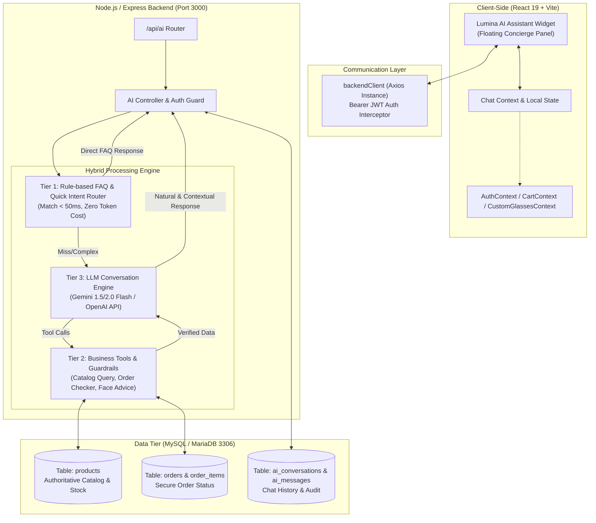
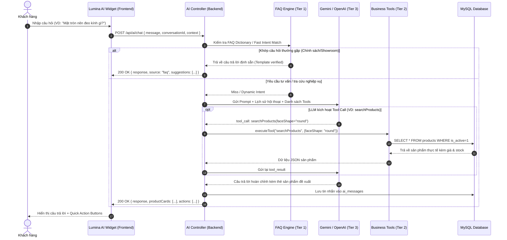
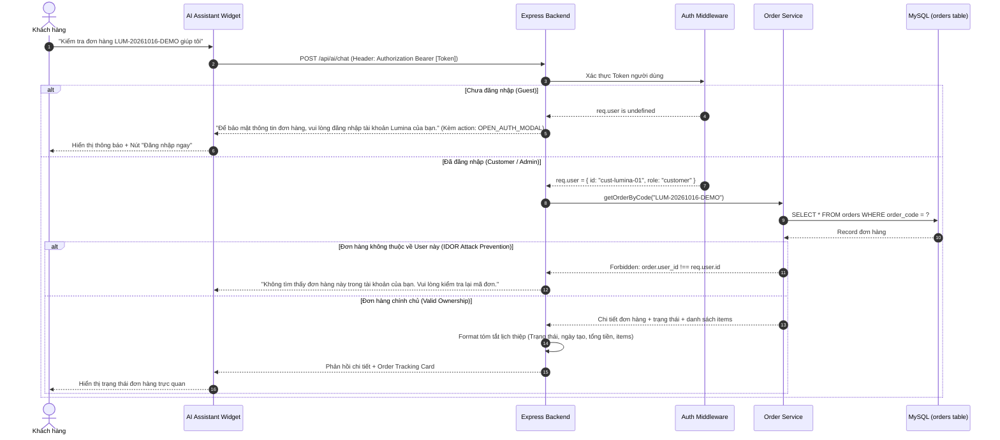
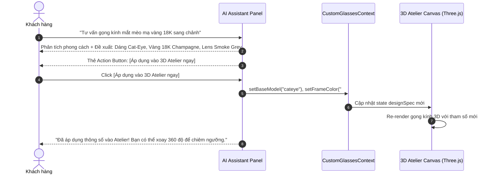

# LUMINA AI ASSISTANT — KIẾN TRÚC TỔNG THỂ HỆ THỐNG
**Tài liệu Kiến trúc Phần mềm & AI Integration**  
*Phiên bản:* 1.0.0 — *Dự án:* Lumina Eyewear — *Tác giả:* Senior Software Architect  
*Mã tài liệu:* `LUMINA_AI_ARCHITECTURE.md`

---

## 1. TỔNG QUAN & MỤC TIÊU DỰ ÁN

Lumina Eyewear là nền tảng thương mại điện tử kính mắt cao cấp (Luxury Eyewear Atelier) tích hợp các công nghệ tiên tiến:
- **3D Atelier Studio** (Three.js WebGL procedural customization)
- **AI Virtual Try-On** (MediaPipe FaceMesh 478 Landmark face shape detection)
- **Hệ thống thương mại điện tử đầy đủ**: Giỏ hàng, Đặt hàng, Thanh toán, và Quản trị MySQL (XAMPP).

Mục tiêu của **Lumina AI Assistant** là đóng vai trò như một **Chuyên viên tư vấn phong cách & Chăm sóc khách hàng cá nhân (Personal Eyewear Stylist & Concierge)** trực tuyến 24/7, kết nối liền mạch với hệ thống dữ liệu thực tế của Lumina, mang lại trải nghiệm xa xỉ, chuẩn xác và tức thì.

### Các nguyên tắc bất khả xâm phạm (Theo QUYTAT.md)
1. **Bảo toàn hiện trạng**: Không viết lại kiến trúc hoặc thay thế các module đang hoạt động (Catalog, Auth, RBAC, Cart, Checkout, Admin, 3D Studio, Try-On).
2. **Nguồn dữ liệu có thẩm quyền**: Dữ liệu sản phẩm, giá, tồn kho và đơn hàng phải truy xuất trực tiếp từ MySQL. AI không được tự ý bịa đặt (hallucinate).
3. **Bảo mật API Key**: Tuyệt đối không hardcode API Key (Gemini/OpenAI) ở Frontend; toàn bộ logic LLM được đóng gói tại Backend Node.js.
4. **An toàn cơ sở dữ liệu**: AI không bao giờ thực thi SQL trực tiếp. Mọi thao tác truy xuất dữ liệu phải thông qua các Backend Business Tools có tham số hóa và kiểm soát IDOR.

---

## 2. MÔ HÌNH KIẾN TRÚC HYBRID 3 LỚP (3-TIER HYBRID ARCHITECTURE)

Hệ thống được thiết kế theo mô hình **Hybrid AI Architecture** kết hợp giữa tốc độ, độ chính xác của Rule-based và khả năng hiểu ngôn ngữ tự nhiên sâu sắc của Large Language Model:



### Chi tiết 3 tầng xử lý:

1. **Tier 1: Rule-based FAQ & Pattern Router**:
   - Xử lý các câu hỏi phổ biến, có tính quy tắc cố định (Chính sách bảo hành, đổi trả, phí giao hàng, địa chỉ showroom, hướng dẫn chọn size kính).
   - Cơ chế: So khớp từ khóa / biểu thức chính quy (Regex) và phân loại Intent với độ tin cậy cao.
   - Ưu điểm: Phản hồi siêu tốc (< 50ms), không tiêu tốn token của LLM, chính xác 100%, không lo rủi ro ảo giác thông tin.

2. **Tier 2: Controlled Business Tools (Backend Data Gate)**:
   - Các hàm nghiệp vụ đóng gói sẵn có kiểm tra phân quyền chặt chẽ:
     - `searchProducts({ category, maxPrice, faceShape, keyword })`: Truy vấn bảng `products` từ MySQL.
     - `checkInventory({ productId })`: Kiểm tra tồn kho khả dụng tức thời.
     - `getCustomerOrder({ orderCode, userId })`: Tra cứu thông tin đơn hàng có xác thực `user_id` chống IDOR.
     - `getFaceStylingRules({ faceShape })`: Trích xuất cẩm nang phối dáng kính từ `configService`.
     - `getStudioPresets({ style })`: Cung cấp cấu hình mẫu cho 3D Studio Atelier.

3. **Tier 3: LLM Conversation Engine (Gemini / OpenAI)**:
   - Tiếp nhận câu hỏi của người dùng kèm theo System Prompt định hình phong cách **Lumina Luxury Stylist**.
   - Có cơ chế **Function Calling (Tool Calling)** để gọi các Business Tools ở Tier 2 khi cần lấy dữ liệu thực tế.
   - Tổng hợp dữ liệu thành câu trả lời lịch thiệp, sang trọng, tinh tế bằng tiếng Việt chuẩn mực.

---

## 3. SƠ ĐỒ LUỒNG DỮ LIỆU CHÍNH (DATA FLOW DIAGRAMS)

### 3.1. Luồng Hội thoại & Phân loại Ý định (Conversation & Intent Flow)



---

### 3.2. Luồng Tra cứu Đơn hàng Bảo mật (Order Lookup with IDOR Protection)



---

### 3.3. Luồng Tương tác giữa AI Assistant và 3D Studio Atelier / Try-On



---

## 4. QUY TẮC BẢO MẬT & PHÂN QUYỀN (SECURITY & RBAC MATRIX)

| Hành động của AI Assistant | Khách vãng lai (Guest) | Khách hàng (Customer) | Quản trị viên (Admin) | Biện pháp bảo vệ |
| :--- | :---: | :---: | :---: | :--- |
| **Hỏi đáp FAQ / Chính sách** | Cho phép | Cho phép | Cho phép | Rate limiting IP |
| **Tư vấn sản phẩm / Dáng mặt** | Cho phép | Cho phép | Cho phép | Sanitization prompt |
| **Tra cứu đơn hàng** | **Bị chặn** (Yêu cầu đăng nhập) | **Chỉ xem đơn của chính mình** | Xem được tất cả đơn | IDOR Check (`user_id === req.user.id`) |
| **Áp dụng thông số 3D Studio** | Cho phép xem/thử | Cho phép | Cho phép | Frontend Context setter |
| **Thêm vào giỏ hàng** | Cho phép | Cho phép | Bị chặn (Admin không mua hàng) | RBAC Customer Enforced |
| **Tiến hành thanh toán** | **Bị chặn** (Yêu cầu đăng nhập) | Cho phép | Bị chặn | Middleware `requireCustomer` |
| **Thay đổi giá/tồn kho sản phẩm** | **Bị chặn tuyệt đối** | **Bị chặn tuyệt đối** | **Bị chặn tuyệt đối** | AI Read-only API, cấm mutation |

---

## 5. THIẾT KẾ CƠ SỞ DỮ LIỆU CHO AI ASSISTANT

Để duy trì ngữ cảnh trò chuyện, hỗ trợ phân tích trải nghiệm và đánh giá chất lượng câu trả lời của AI mà không làm ảnh hưởng đến các bảng thương mại cốt lõi (`products`, `orders`, `payments`), thiết kế bổ sung 2 bảng mới:

### 5.1. Bảng `ai_conversations` (Lưu phiên trò chuyện)
```sql
CREATE TABLE IF NOT EXISTS `ai_conversations` (
  `id` VARCHAR(50) NOT NULL,
  `user_id` VARCHAR(100) NULL COMMENT 'NULL nếu là khách vãng lai (Guest)',
  `session_token` VARCHAR(100) NOT NULL COMMENT 'UUID định danh session trình duyệt',
  `title` VARCHAR(255) NULL DEFAULT 'Cuộc trò chuyện mới',
  `context_metadata` JSON NULL COMMENT 'Lưu thông tin phụ: dáng mặt nhận diện, trang hiện tại',
  `created_at` TIMESTAMP DEFAULT CURRENT_TIMESTAMP,
  `updated_at` TIMESTAMP DEFAULT CURRENT_TIMESTAMP ON UPDATE CURRENT_TIMESTAMP,
  PRIMARY KEY (`id`),
  INDEX `idx_ai_conv_user` (`user_id`),
  INDEX `idx_ai_conv_session` (`session_token`)
) ENGINE=InnoDB DEFAULT CHARSET=utf8mb4 COLLATE=utf8mb4_unicode_ci;
```

### 5.2. Bảng `ai_messages` (Lưu lịch sử tin nhắn)
```sql
CREATE TABLE IF NOT EXISTS `ai_messages` (
  `id` BIGINT UNSIGNED AUTO_INCREMENT NOT NULL,
  `conversation_id` VARCHAR(50) NOT NULL,
  `role` ENUM('user', 'assistant', 'system', 'tool') NOT NULL,
  `content` TEXT NOT NULL,
  `intent` VARCHAR(50) NULL COMMENT 'faq, order_tracking, styling_advice, product_search',
  `tool_calls` JSON NULL COMMENT 'Ghi nhận chi tiết function call nếu có',
  `rating` ENUM('liked', 'disliked', 'none') DEFAULT 'none',
  `created_at` TIMESTAMP DEFAULT CURRENT_TIMESTAMP,
  PRIMARY KEY (`id`),
  INDEX `idx_ai_msg_conv` (`conversation_id`),
  CONSTRAINT `fk_ai_msg_conv` FOREIGN KEY (`conversation_id`) REFERENCES `ai_conversations` (`id`) ON DELETE CASCADE
) ENGINE=InnoDB DEFAULT CHARSET=utf8mb4 COLLATE=utf8mb4_unicode_ci;
```

---

## 6. SỰ ĐỒNG BỘ GIỮA CÁC MODULE HIỆN CÓ

| Module hiện có | Điểm tích hợp của Lumina AI Assistant | Dữ liệu chia sẻ |
| :--- | :--- | :--- |
| **`CustomGlassesContext`** | Hook `useCustomGlasses()` | Đọc & ghi `designSpec`, áp dụng màu gọng, kiểu dáng ngay từ lời tư vấn của AI. |
| **`CartContext`** | Hook `useCart()` | AI hiển thị thẻ sản phẩm kèm nút "Thêm vào giỏ hàng", trực tiếp gọi `addToCart(product)`. |
| **`AuthContext`** | Hook `useAuth()` | Kiểm tra quyền truy cập khi hỏi đơn hàng, kích hoạt `openAuthModal` khi khách cần đăng nhập. |
| **`AIVirtualTryOn`** | `faceLandmarkAnalyzer.js` | AI Assistant nhận diện được dáng mặt người dùng vừa quét để gợi ý mẫu kính tương thích. |
| **`MySQL Products`** | Backend `aiTools.service.js` | Dữ liệu giá niêm yết và tồn kho thực tế, không bao giờ bịa giá sai lệch. |
| **`MySQL Orders`** | Backend `order.controller.js` | Trả về trạng thái chuẩn hóa: `pending`, `confirmed`, `processing`, `completed`. |

---
*Tài liệu đã được kiểm duyệt bởi Senior Software Architect — Sẵn sàng cho giai đoạn lập kế hoạch chi tiết.*

